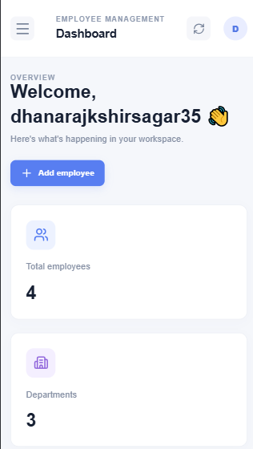
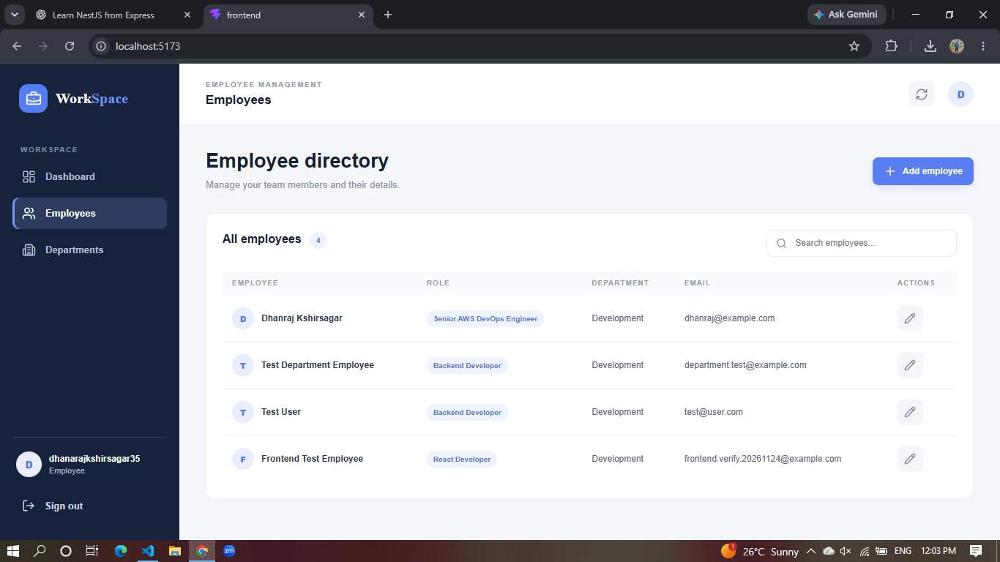
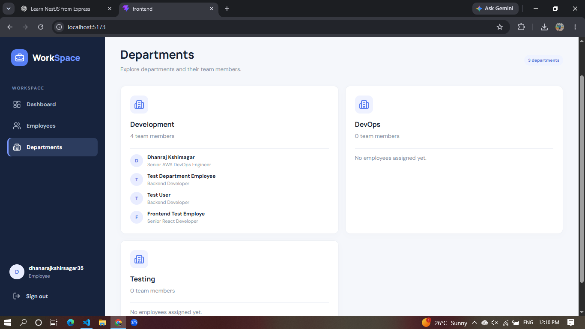

# Full-Stack Employee Management System

A full-stack employee management application built with **React, Vite, NestJS, TypeScript, and MySQL**. The React frontend consumes protected REST APIs from the NestJS backend for authentication, employee management, and department views.

## Application Screenshots

### Dashboard — responsive mobile layout



### Employee directory



### Departments and team members



## Features

### Authentication and authorization
- User registration and login
- JWT-based authentication using Passport
- Protected profile, employee, and department endpoints
- Role-based authorization for employee deletion (admin only)

### Employee management
- List employees and view employee details
- Create and update employee records
- Update employee job roles
- Search employees by name, email, role, or department in the frontend
- Admin-only employee deletion

### Department management
- List departments and view a department with its employees
- TypeORM `ManyToOne` / `OneToMany` employee–department relationship
- Department names and employee memberships displayed in the frontend

### Dashboard and API documentation
- Dashboard summaries for employees, departments, and signed-in role
- Responsive React layout
- Swagger / OpenAPI documentation with DTO schemas and JWT Bearer authentication

## Technology Stack

| Layer | Technologies |
|---|---|
| Frontend | React 19, Vite 8, JavaScript |
| UI and icons | CSS, Lucide React |
| HTTP client | Axios |
| Backend | NestJS 12, TypeScript, Node.js |
| Authentication | JWT, Passport, bcrypt |
| Validation | class-validator, class-transformer |
| ORM and database | TypeORM, MySQL |
| API documentation | Swagger / OpenAPI (`@nestjs/swagger`) |
| Testing | Vitest, Supertest, `@nestjs/testing` |

## Repository Structure

```text
employee-management/
├── backend/
│   ├── src/
│   │   ├── auth/
│   │   ├── common/
│   │   ├── departments/
│   │   ├── employees/
│   │   ├── users/
│   │   ├── app.module.ts
│   │   └── main.ts
│   ├── test/
│   ├── .env.example
│   ├── package.json
│   └── package-lock.json
├── frontend/
│   ├── src/
│   │   ├── App.jsx
│   │   ├── index.css
│   │   └── main.jsx
│   ├── public/
│   ├── .env.example
│   ├── package.json
│   └── package-lock.json
├── docs/
│   └── screenshots/
│       ├── dashboard-mobile.png
│       ├── employee-directory.png
│       └── departments.png
├── .gitignore
└── README.md
```

## Prerequisites

- Node.js and npm
- MySQL Server

## Getting Started

### 1. Create the database

Create the database in MySQL:

```sql
CREATE DATABASE employee_management_db;
```

The backend uses TypeORM entity synchronization in the current development configuration. On a fresh database, the department records must be seeded before employees are created:

```sql
USE employee_management_db;

INSERT INTO departments (id, name)
VALUES
  (1, 'Development'),
  (2, 'Testing'),
  (3, 'DevOps');
```

Run the seed statement only when these department rows do not already exist.

### 2. Configure and start the backend

From the repository root:

```powershell
cd backend
npm ci
Copy-Item .env.example .env
```

Edit `backend/.env` with your local MySQL credentials and a strong, private JWT secret. Do not commit this file.

Example backend environment variables:

```env
DB_HOST=localhost
DB_PORT=3306
DB_USERNAME=root
DB_PASSWORD=your_mysql_password
DB_DATABASE=employee_management_db
JWT_SECRET=replace_with_a_long_random_secret
PORT=3000
```

Start NestJS in development mode:

```powershell
npm run start:dev
```

Backend base URL: `http://localhost:3000/api`

Swagger UI: `http://localhost:3000/api/docs`

### 3. Configure and start the frontend

Open a second terminal from the repository root:

```powershell
cd frontend
npm ci
Copy-Item .env.example .env.local
```

The frontend environment file should contain:

```env
VITE_API_URL=http://localhost:3000/api
```

Start Vite:

```powershell
npm run dev
```

Frontend URL: `http://localhost:5173`

## API Overview

All backend routes use the `/api` prefix.

### Authentication

| Method | Endpoint | Purpose |
|---|---|---|
| POST | `/api/auth/register` | Register an account |
| POST | `/api/auth/login` | Sign in and receive a JWT |
| GET | `/api/auth/profile` | Get the authenticated profile |

### Employees

| Method | Endpoint | Purpose |
|---|---|---|
| GET | `/api/employees` | List employees |
| GET | `/api/employees/:id` | Get an employee |
| POST | `/api/employees` | Create an employee |
| PUT | `/api/employees/:id` | Update employee details |
| PATCH | `/api/employees/:id/role` | Update employee role |
| DELETE | `/api/employees/:id` | Delete an employee (admin only) |
| GET | `/api/employees/active?status=true` | Return the requested active-status value |

### Departments

| Method | Endpoint | Purpose |
|---|---|---|
| GET | `/api/departments` | List departments with employees |
| GET | `/api/departments/:id` | Get one department with employees |

Protected endpoints require the JWT in the request header:

```http
Authorization: Bearer <access_token>
```

## Testing and Builds

Run backend commands from `backend/`:

```powershell
npm test
npm run test:e2e
npm run build
```

Run the frontend production build from `frontend/`:

```powershell
npm run build
```

### Verified results during development

- Backend unit tests: **50 passed** across 15 test files
- Backend end-to-end tests: **4 passed**
- Backend production build: **successful**
- Frontend production build: **successful**

## Current Implementation Notes

- New registrations receive the `employee` role by default; the public registration form does not assign an admin role.
- Employee deletion is restricted to an authenticated admin.
- Employee and department records are stored in MySQL.
- The current `UsersService` stores users in memory. Registered accounts are lost when the backend process restarts; user persistence in MySQL is a recommended next improvement.
- TypeORM `synchronize` is currently enabled for development. Use reviewed migrations and disable synchronization before production deployment.
- Configure production CORS, HTTPS, secret management, database migrations, and persistent user storage before public deployment.

## Future Improvements

- Persist users in MySQL
- Add department create, update, and delete endpoints
- Add pagination and server-side employee filtering
- Add automated database migrations
- Add production deployment and monitoring

## Author

**Dhanraj Shekhar Kshirsagar**

Full-Stack Developer | React | NestJS | TypeScript | MySQL
